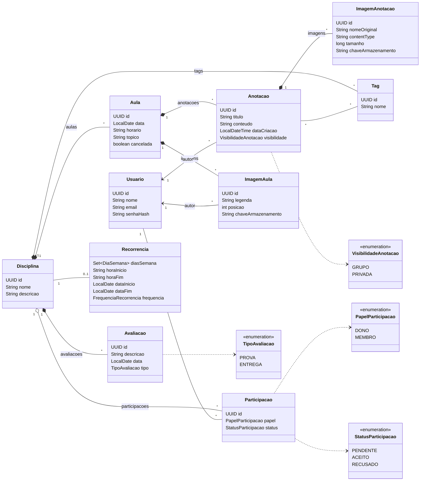
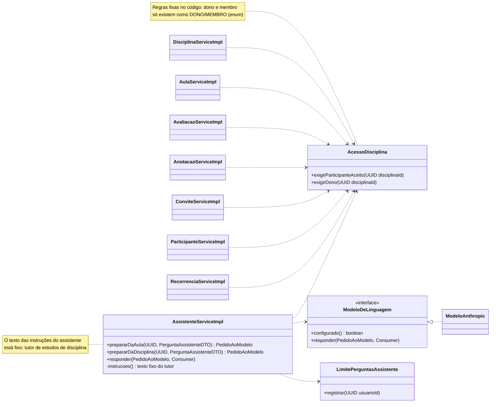
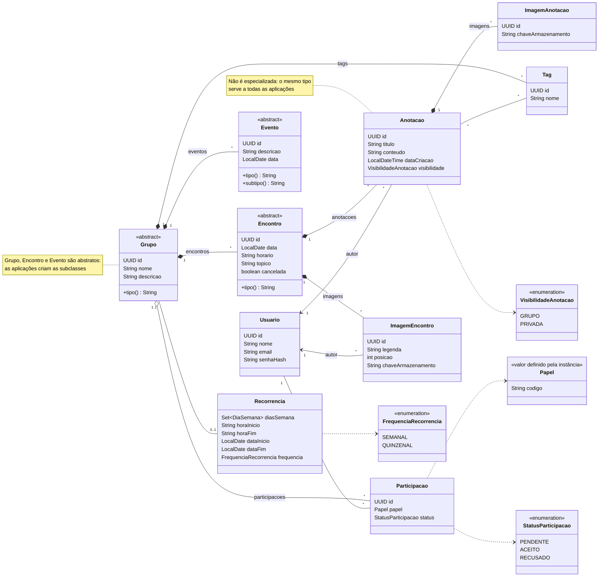
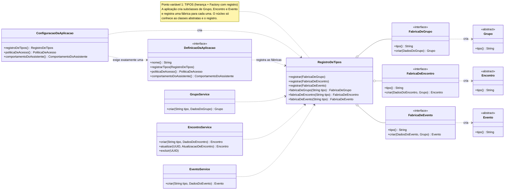
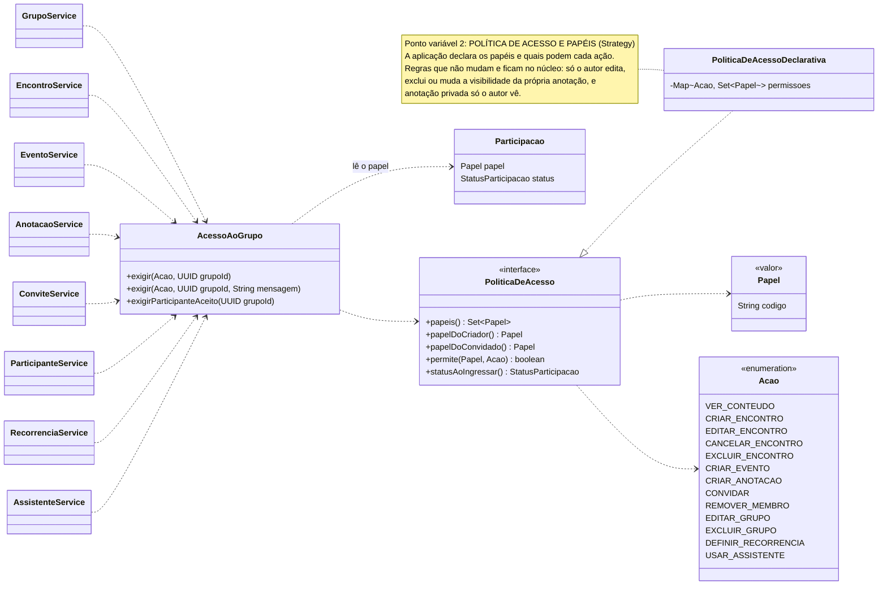
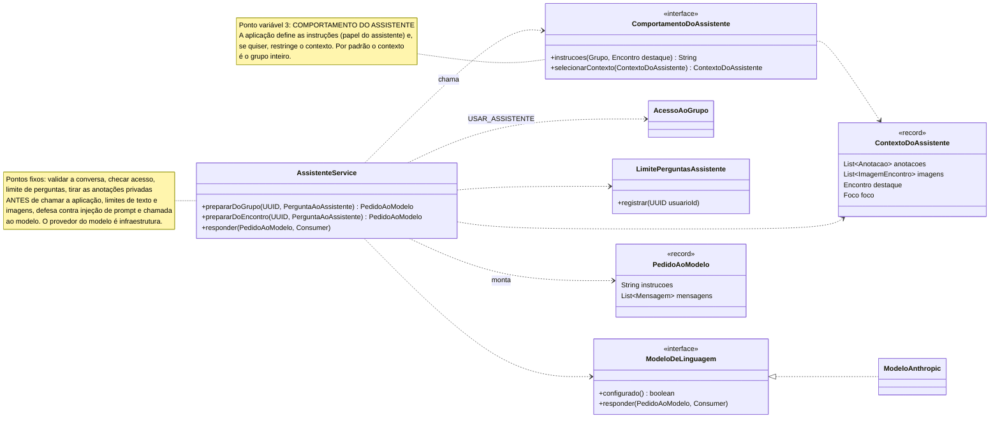
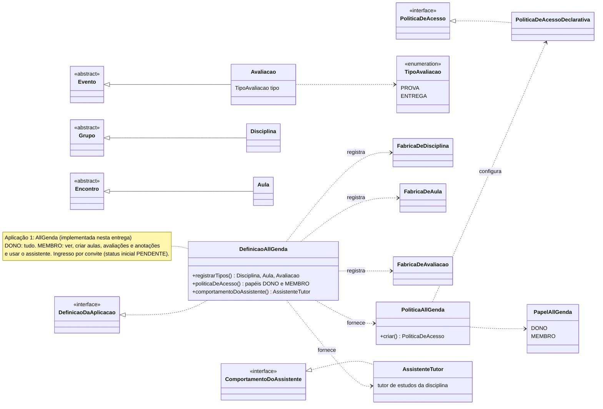

# Diagrama de classes: do AllGenda (versão 1) ao framework

Este documento acompanha a entrega "diagrama de classes indicando as mudanças feitas na versão 1 para atender o framework, o código-fonte do framework e a aplicação 1 instanciada". Os diagramas estão em Mermaid (o GitHub desenha direto). As imagens para slides estão em `docs/framework/img/`.

**Legenda das marcações**
- ✅ **Combinado**: decidido com o grupo/professor ao longo da conversa.
- 🔶 **Proposta**: detalhe de projeto necessário para fechar o diagrama. As propostas foram fechadas no roteiro (`ROTEIRO-REFATORACAO.md`) e implementadas; a seção 7 resume como ficou no código.

## 1. O framework em uma frase

Domínio: **gestão colaborativa de encontros e conteúdo por grupos**. Pessoas se reúnem em grupos, marcam encontros (que podem se repetir), registram eventos especiais e escrevem anotações (do grupo ou privadas), com um assistente de IA que responde com base nas anotações. ✅

- **Pontos fixos (núcleo):** `Grupo`, `Encontro`, `Evento`, `Anotacao` (sem especialização), `Participacao`, `Tag`, `Usuario` e autenticação, `Recorrencia`, imagens, e o mecanismo do assistente (acesso, limite de perguntas, chamada ao modelo, filtro de visibilidade, tratamento de erros, defesa contra injeção de prompt). ✅
- **Pontos variáveis (hot spots):** ✅
  1. **Tipos especializados** de Grupo, Encontro e Evento (herança + Factory com registro).
  2. **Política de acesso e papéis** (Strategy, declarativa).
  3. **Comportamento do assistente** (instruções e contexto).
- **Instanciação:** pontos 1 por **herança** e pontos 2 e 3 por **composição/configuração**, o que faz do framework **caixa-cinza**. ✅
- **Instância desta entrega:** AllGenda (aplicação 1, implementada no código do framework). Outras aplicações (Mesa de RPG, Clube do livro) ficam para depois. ✅

## 2. Versão 1 (antes da refatoração)

Modelo de domínio da versão 1, antes da refatoração (pacote `com.allgenda.model`).

Serviços e regras que a refatoração mexe. Hoje o papel é um enum fixo (`DONO`/`MEMBRO`), a checagem de acesso é uma classe fixa e o texto do assistente é fixo no código.

## 3. Framework: núcleo (pontos fixos)

`Disciplina`, `Aula` e `Avaliacao` deixam de ser classes do núcleo: viram subclasses das abstratas `Grupo`, `Encontro` e `Evento`. `ImagemAula` vira `ImagemEncontro`. O papel deixa de ser enum fixo (`Papel` é definido pela aplicação).

## 4. Os três pontos variáveis

### 4.1 Ponto 1: tipos especializados (herança + Factory com registro) ✅

Cada aplicação cria subclasses das três abstratas e registra uma fábrica por tipo. O núcleo cria pelo nome do tipo, sem conhecer as subclasses (inversão de controle). Decidido: `Evento` ganha uma subclasse por aplicação, que carrega um enum com os tipos de evento (`subtipo()` devolve o nome dele). `Anotacao` não é especializada.

Divisão do trabalho na criação: o service do núcleo valida os dados comuns, pede a fábrica ao registro (tipo desconhecido dá 400), confere o grupo e a permissão, deixa a fábrica instanciar a subclasse e validar o que é dela (ex.: `FabricaDeAvaliacao` exige PROVA ou ENTREGA) e só então preenche os campos comuns e grava. Quem liga a aplicação ao núcleo é a `ConfiguracaoDaAplicacao`: ela exige exatamente uma `DefinicaoDaAplicacao` e chama `registrarTipos` na inicialização.

### 4.2 Ponto 2: política de acesso e papéis (Strategy declarativa) ✅

Cada aplicação declara seus papéis e um mapa `Acao -> papéis permitidos`. Todo serviço do núcleo pergunta ao `AcessoAoGrupo` (que substitui o `AcessoDisciplina`), passando a ação e a mensagem do 403. A lista de `Acao` vem do que o código da versão 1 já exigia; as ações `EDITAR_ENCONTRO`, `CANCELAR_ENCONTRO`, `EXCLUIR_ENCONTRO`, `REMOVER_MEMBRO`, `EDITAR_GRUPO` e `DEFINIR_RECORRENCIA` entraram com os commits preparatórios. A `PoliticaDeAcessoDeclarativa` é montada por um construtor (`papel(DONO, Acao.values())`, `papelDoCriador(...)`...) e recusa, já na inicialização, criador ou convidado que não estejam entre os papéis declarados.

**Regras que NÃO são política (ficam fixas no núcleo):** só o autor edita, exclui ou muda a visibilidade da própria anotação (e edita ou remove as próprias imagens); anotação privada só o autor vê (nem o dono, nem o assistente); só participante aceito acessa o grupo; quem criou o grupo (`papelDoCriador`) não pode ser removido; só o convidado responde ao próprio convite.

**Matriz de permissões da aplicação 1 (AllGenda), igual ao comportamento atual:**

| Ação | DONO | MEMBRO |
|---|:-:|:-:|
| VER_CONTEUDO | ✔ | ✔ |
| CRIAR_ENCONTRO | ✔ | ✔ |
| EDITAR_ENCONTRO, CANCELAR_ENCONTRO, EXCLUIR_ENCONTRO | ✔ | |
| CRIAR_EVENTO | ✔ | ✔ |
| CRIAR_ANOTACAO (também tags e imagens do encontro) | ✔ | ✔ |
| CONVIDAR, REMOVER_MEMBRO | ✔ | |
| EDITAR_GRUPO, EXCLUIR_GRUPO, DEFINIR_RECORRENCIA | ✔ | |
| USAR_ASSISTENTE | ✔ | ✔ |

### 4.3 Ponto 3: comportamento do assistente ✅

O núcleo faz tudo que é sensível e só depois entrega à aplicação o que a pessoa pode ver. A aplicação define as instruções e, se quiser, restringe o contexto (padrão: o grupo inteiro).

O assistente funciona por grupo (`POST /api/disciplinas/{id}/assistente`) e por encontro em destaque (`POST /api/aulas/{id}/assistente`); a refatoração generalizou os nomes e tirou o texto da persona para o `ComportamentoDoAssistente`.

Fluxo fixo do núcleo, nesta ordem: validar a conversa, exigir `USAR_ASSISTENTE`, conferir o modelo (503), carregar o material, **tirar as anotações privadas**, chamar `selecionarContexto`, **descartar do resultado tudo o que não estava no contexto original** (a aplicação só reduz ou reordena), numerar, validar o foco, contar o limite de perguntas e montar o pedido. As instruções são as da aplicação seguidas de uma parte fixa do núcleo (o material é conteúdo de consulta, nunca instruções; citar as fontes; avisar o que ficou de fora).

## 5. Aplicações instanciadas

Ponto de entrada da aplicação: `DefinicaoDaAplicacao` (uma classe por aplicação, anotada com `@Component`, que registra os tipos e fornece a política e o assistente).

### 5.1 Aplicação 1: AllGenda (instanciada no framework) ✅

### 5.2 Outras aplicações (fora desta entrega)

Mesa de RPG e Clube do livro foram pensadas só para validar os pontos variáveis do framework e ficam para depois. Nesta entrega, a única aplicação instanciada é o AllGenda.

## 6. Mapa de migração: versão 1 → framework

| Versão 1 | Framework | O que muda |
|---|---|---|
| `Disciplina` | `Grupo` (abstrata, núcleo) + `Disciplina extends Grupo` (AllGenda) | Campos comuns sobem; a classe concreta fica na aplicação |
| `Aula` | `Encontro` (abstrata) + `Aula extends Encontro` | Idem; `cancelada` e `topico` ficam no núcleo |
| `Avaliacao` + `TipoAvaliacao` | `Evento` (abstrata) + `Avaliacao extends Evento`; `TipoAvaliacao` fica na aplicação | O enum de tipos passa a ser da instância |
| `Anotacao` | `Anotacao` | Só troca `aula` por `encontro`; continua sem especialização |
| `ImagemAula` | `ImagemEncontro` | Renomeada |
| `ImagemAnotacao`, `Tag`, `Usuario` | iguais | `Tag.disciplina` vira `Tag.grupo` |
| `Participacao` | `Participacao` | `disciplina` vira `grupo`; `papel` deixa de ser enum fixo e vira `Papel` definido pela aplicação |
| `PapelParticipacao` (DONO/MEMBRO) | `Papel` no núcleo; `DONO`/`MEMBRO` declarados pelo AllGenda | Os valores gravados no banco continuam os mesmos |
| `StatusParticipacao`, `VisibilidadeAnotacao` | iguais | Núcleo |
| `Recorrencia` | `Recorrencia` | `disciplina` vira `grupo`; continua 0..1 por grupo |
| `AcessoDisciplina` | `AcessoAoGrupo` | Consulta a `PoliticaDeAcesso` em vez de regras fixas |
| `DisciplinaService` | `GrupoService` (+ fábrica de tipos) | Cria por tipo |
| `AulaService` | `EncontroService` | Idem; editar, cancelar e excluir viram ações da política |
| `AvaliacaoService` | `EventoService` | Idem |
| `AnotacaoService`, `ConviteService`, `ParticipanteService`, `RecorrenciaService`, `TagService`, `ImagemAnotacaoService` | mesmos nomes | Trocam `AcessoDisciplina` por `AcessoAoGrupo` |
| `ImagemAulaService` | `ImagemEncontroService` | Renomeado |
| `AssistenteServiceImpl` (texto fixo do tutor) | `AssistenteService` (núcleo) + `ComportamentoDoAssistente` | Instruções e contexto saem para o ponto variável; `AssistenteTutor` é a implementação do AllGenda |
| `ModeloDeLinguagem`, `ModeloAnthropic`, `LimitePerguntasAssistente`, `ArmazenamentoService`, autenticação JWT | iguais | Infraestrutura e núcleo, sem mudança |
| `DisciplinaNaoEncontradaException`, `AulaNaoEncontradaException` | `GrupoNaoEncontradoException`, `EncontroNaoEncontradoException` | Mensagens neutras; status iguais |
| `controller/*`, `dto/*`, `mapper/*` | `aplicacao.allgenda.{controller,dto,mapper}` | Rotas e JSON do AllGenda; login e cadastro de usuário ficam no núcleo |
| `MigracaoTagsPorDisciplina` | removida | Era migração de dados de um banco antigo |

## 7. Como ficou no código

Um módulo Maven (`allgenda/`), com dois pacotes raiz. O núcleo nunca importa a aplicação (o teste `NucleoNaoDependeDaAplicacaoTest` garante).

| Pacote | O que tem |
|---|---|
| `com.allgenda.framework.model` | `Grupo`, `Encontro`, `Evento` (abstratas, herança `JOINED`: tabelas `grupos`, `encontros`, `eventos`), `Anotacao`, `ImagemAnotacao`, `ImagemEncontro`, `Tag`, `Participacao`, `Usuario`, `Recorrencia` e enums |
| `com.allgenda.framework.acesso` | `Papel` (+ `PapelConverter`), `Acao`, `PoliticaDeAcesso`, `PoliticaDeAcessoDeclarativa`, `AcessoAoGrupo` |
| `com.allgenda.framework.extensao` | `DefinicaoDaAplicacao`, `RegistroDeTipos`, `FabricaDeGrupo/Encontro/Evento`, `DadosDoGrupo/Encontro/Evento` |
| `com.allgenda.framework.assistente` | `AssistenteService(+Impl)`, `ComportamentoDoAssistente`, `ContextoDoAssistente`, `PerguntaAoAssistente`, `ModeloDeLinguagem`, `ModeloAnthropic`, `PedidoAoModelo`, `LimitePerguntasAssistente`, `FalhaDoModeloException` |
| `com.allgenda.framework.{repository,service,exception,config}` | repositórios, services (que recebem e devolvem entidades e records neutros), exceções e `GlobalExceptionHandler`, segurança, CORS, usuário de teste e `ConfiguracaoDaAplicacao` |
| `com.allgenda.framework.{controller,dto}` | só os neutros: login (`/api/auth`) e cadastro de usuário (`/api/usuarios`) |
| `com.allgenda.aplicacao.allgenda` | `DefinicaoAllGenda`, `FabricaDeDisciplina/Aula/Avaliacao`, `PoliticaAllGenda`, `AssistenteTutor`; `model` (`Disciplina`, `Aula`, `Avaliacao`, `TipoAvaliacao`, `PapelAllGenda`); `controller`, `dto` e `mapper` com as rotas e o JSON do AllGenda, que não mudaram |

Decisões tomadas na implementação (além das do roteiro):

- **Quem preenche o quê na criação.** A fábrica só instancia a subclasse e preenche o que é dela; os campos comuns, já validados, o núcleo preenche depois. Assim as validações comuns ficam num lugar só.
- **Ordem das validações de evento.** O subtipo (PROVA/ENTREGA) é validado pela fábrica, depois de conferir o grupo (404) e a permissão (403). Antes, um pedido com tipo inválido *e* grupo inexistente dava 400; agora dá 404. Nos demais casos nada muda.
- **Editar, excluir ou mudar a visibilidade da própria anotação, e editar ou remover a própria imagem do encontro**, continuam com a regra fixa do autor e sem `Acao`: na versão 1 não havia checagem de participação nesses casos, e acrescentá-la barraria quem antes passava.
- **`PATCH` do encontro**: exige `EDITAR_ENCONTRO` e também `CANCELAR_ENCONTRO` quando o campo `cancelada` vem informado.
- **Vocabulário neutro no núcleo.** Mensagens de erro e o material enviado ao assistente falam em grupo e encontro. Os status HTTP e o JSON não mudaram; só os textos de algumas mensagens.
- **Banco.** As tabelas mudaram e não há migração (os dados eram de teste): o banco local precisa ser recriado com `mise run db:reset`. Os testes usam H2 em memória.
- **Testes.** Os 224 testes da versão 1 continuam (menos os 2 da migração removida, mais os novos): 240 no total. Os novos cobrem a política declarativa com papéis de outra aplicação, o registro de tipos, a exigência de exatamente uma `DefinicaoDaAplicacao`, a privacidade do assistente diante de uma aplicação que tenta acrescentar uma anotação privada e a regra de arquitetura.

## 8. Adiado ou fora do escopo ✅

Presença em sessões (ideia da instância Mesa de RPG), configurar o assistente pelo mestre, ingresso por código, periodicidade mensal (hoje só semanal e quinzenal, e "não periódico" é não ter recorrência), notificações, e o radar de carga/desempenho (calculado fora do framework).
